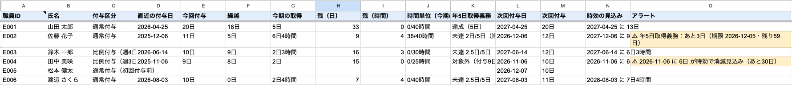

# 有給休暇管理シート（デモ）

職員の **有給休暇の付与・取得・残日数** を、Google スプレッドシート1枚で自動管理するサンプルです。
休みを取った日を1行書くだけで、残日数・時間単位の使用量・年5日の取得義務・時効の見込みまで自動で出ます。

> これは「AI業務効率化」のデモです。**登録されている職員はすべて架空のダミーデータ**で、実在の人物・組織とは関係ありません。
> 計算ルールは一般的な労働基準法の定めをもとにしています。**実際の運用は、自社の就業規則・労使協定に合わせて調整してください**（「設定」タブで変更できます）。
> 作者: なおと（Webライター × AI業務自動化サポート）

**▶ [公開デモを見る（閲覧のみ）](https://docs.google.com/spreadsheets/d/1oqeulSjH6zuJE_Db0N2f05hmRHyuvYnbwaF3wdauU14/edit?usp=sharing)**



---

## 何がうれしいのか

- **数えなくていい**: 入社日と所定労働日数から、法定の付与日数（パート・短時間勤務の比例付与も）を自動で出す。
- **取りこぼさない**: 年5日の取得義務が未達のまま期限が近い人、2年の時効で消えそうな日数を、アラートで先に知らせる。
- **時間単位も一緒に管理**: 1日＝所定労働時間で換算し、時間単位の年5日上限を超える入力はその場で止める。
- **壊れにくい**: 入力欄以外は保護。誰がいつ何を変えたかは「更新履歴」に自動で残る。

## できること

| 機能 | 内容 |
|---|---|
| 職員マスタ | 職員ID・氏名・入社日・週所定労働日数・週所定労働時間・1日の所定労働時間 |
| 法定の付与日数 | 入社6か月後に初回付与、以後1年ごと。通常の付与と、週4日以下の比例付与（表は下記） |
| 時間単位年休 | 1日＝1日の所定労働時間（端数は切り上げ。7.5時間→8時間）で換算。年5日分の上限を追跡し、超える入力は「✖」判定 |
| 取得記録 | 全日・半日・時間の3区分。1行ごとに「✔ 計上（この時点の残）」か、エラー理由を自動表示 |
| 残日数 | 付与ごとに、使用・時効消滅・切り捨てを追跡して「X日Y時間」で表示（古い付与＝繰越分から先に使う） |
| 時効の見込み | 付与から2年で消滅。いちばん近い消滅日と日数を表示し、警告期間（既定90日）に入るとアラート |
| 保有上限 | 付与の時点で保有が上限（既定40日）を超えたら、古い付与から切り捨て |
| 年5日の取得義務 | 年10日以上付与される人について、付与日から1年以内の取得日数（全日＝1・半日＝0.5）と期限を表示 |
| シート保護 | 入力欄（職員マスタ・取得記録の入力列・設定）以外は保護し、持ち主だけが編集できる |
| 更新履歴 | 入力の変更を「日時・編集者・シート・セル・変更前・変更後」で自動記録。編集者のメールは伏せ字（例: `n***@gmail.com`＝先頭1文字＋ドメインだけ）で残し、取得できない環境では「（不明）」 |

## 動かし方

### ① いちばん簡単：Google Apps Script（1クリックで一式そろえる）

1. Google スプレッドシートを新規作成 →「拡張機能 > Apps Script」を開く
2. `Code.gs` と `LeaveCalc.gs` の2ファイルを作り、このリポジトリの中身をそれぞれ貼る
3. 関数一覧から **`setup`** を選んで▶実行 → 初回だけ認可を「許可」
4. スプレッドシートに戻ると、7つのタブとダミーデータ（6名）ができている
5. 「取得記録」に1行追加 → 数秒で「残日数一覧」が更新され、「更新履歴」に記録が残れば成功

→ タブ・入力規則・保護・トリガー（編集時の再計算／毎朝6時の再計算）はすべて `setup()` が作ります。
何度実行しても、入力済みのデータや設定は上書きしません（職員マスタが空のときだけダミーを入れます）。

### ② 公開中のデモをコピーして使う

1. [公開デモのコピーを作成](https://docs.google.com/spreadsheets/d/1oqeulSjH6zuJE_Db0N2f05hmRHyuvYnbwaF3wdauU14/copy) を開き「コピーを作成」（または公開デモを開いて「ファイル > コピーを作成」）
2. コピーを開くと、メニューに「有給管理」が出る（出ないときは再読み込み）
3. **「有給管理 > 初期設定（コピー後に1回）」を実行** → 認可を「許可」
4. 以後は入力するだけで自動計算

> **3. を忘れないでください。** スクリプトはコピーに付いてきますが、トリガー（自動再計算）とシート保護の「持ち主」はコピーに引き継がれません。
> 実行しないと、入力しても残日数が更新されません（メニューの「再計算」で手動更新はできます）。

### ③ 計算ロジックだけ手元で確かめる（Node.js）

Google にログインせずに、計算の正しさをテストできます。

```bash
npm test             # いくつかの基準日でダミーデータを計算して検証
npm run preview      # 残日数一覧・付与履歴・取得記録の判定を画面に表示
```

## タブの構成

| タブ | 入力 | 内容 |
|---|:---:|---|
| 残日数一覧 | 自動 | 職員ごとの付与区分・今回付与・繰越・今期の取得・残・時間単位の使用量・年5日義務・次回付与・時効の見込み・アラート |
| 取得記録 | ✏️ A〜E列 | 職員ID・取得日・区分（全日/半日/時間）・時間数・備考。F・G列（氏名・判定）は自動 |
| 職員マスタ | ✏️ | 職員の基本情報 |
| 付与履歴 | 自動 | 付与ごとの内訳（付与日数・時効日・使用・時効消滅・上限切捨・残・状態） |
| 設定 | ✏️ 値の列・付与日数テーブル | 計算基準日・保有上限・時効・時間単位の上限・警告日数・付与日数テーブル など |
| 更新履歴 | 自動 | 入力の変更記録 |
| 使い方 | — | 操作の早見表 |

## 前提にした法令ルール

| ルール | このデモでの扱い | 根拠 |
|---|---|---|
| 初回付与 | 入社日から6か月後の応当日に付与（応当日が無い月は翌月1日）。以後1年ごと | 労働基準法39条1項・2項 |
| 出勤率 | **全員が出勤率8割以上を満たしている前提**で計算（出勤率の判定はしない） | 同 39条1項 |
| 通常の付与日数 | 勤続0.5年10日／1.5年11日／2.5年12日／3.5年14日／4.5年16日／5.5年18日／6.5年以上20日 | 同 39条2項 |
| 比例付与 | 週所定労働時間30時間未満 **かつ** 週所定労働日数4日以下の人。週30時間以上または週5日以上なら通常付与 | 同 39条3項・施行規則24条の3 |
| 比例付与の日数 | 週4日: 7/8/9/10/12/13/15　週3日: 5/6/6/8/9/10/11　週2日: 3/4/4/5/6/6/7　週1日: 1/2/2/2/3/3/3（勤続0.5年〜6.5年以上） | 施行規則24条の3 |
| 時間単位年休 | 年5日以内（前年からの繰越分を含めて5日）。1日の時間数は1日の所定労働時間、1時間未満の端数は切り上げ。**導入には労使協定が必要** | 同 39条4項・施行規則24条の4 |
| 半日単位 | 全日の半分の時間として計上。法律上の制度ではなく、就業規則等で定めて運用するもの | 通達（行政解釈） |
| 年5日の取得義務 | その付与日（基準日）に10日以上付与される人が対象。付与日から1年以内に5日。**半日は0.5日として数え、時間単位は数えない** | 同 39条7項・8項 |
| 時効 | 付与日から2年で消滅（2年後の同じ日に消える＝その前日まで使える） | 同 115条 |
| 保有上限 | 付与の時点で上限を超えた分を、古い付与から切り捨て | （下記の注を参照） |

**保有上限（40日）について**: 法定どおりの付与と2年の時効なら、保有は最大で20日＋20日＝40日になり、切り捨ては発動しません。
就業規則で法定を上回る日数を付与するとき用の安全装置です。**上限を40日未満にすると、まだ時効になっていない法定分を切り捨てることになる**ので注意してください。

## 簡略化していること（実運用では就業規則に合わせて調整）

- **使う順番は「古い付与（繰越分）から」**: 法律上の定めは無く、就業規則で決めるものです。多くの職場の慣行に合わせています。
- **労働条件の変更**: 所定労働日数・時間が途中で変わった人も、現在の職員マスタの値で全期間を計算します（本来は各付与日時点の条件で判定）。
- **基準日の統一（斉一的取扱い）**: 全員の付与日を4/1などにそろえる運用には対応していません（入社日ごとの付与のみ）。
- **出勤率**: 8割未満の年は付与しない、といった判定はしていません。
- **週の所定日数が決まっていない人**（年間の所定労働日数で判定する人）には対応していません。
- **計画的付与・使用者による時季指定**: 区別せず「全日」「半日」として記録すれば、年5日の取得数に数えます。
- **半日の時間数**: 全日の半分（1日8時間なら4時間）。1日7時間の人の半日は3.5時間として扱います。

## 設計方針

1. **計算とシート操作を分ける** — 計算は `LeaveCalc.gs`（純粋関数）、シートの読み書きは `Code.gs`。計算の正しさをシートに書く前に手元でテストできる。
2. **入口でミスを止める** — 職員IDはプルダウン、日付・時間数は入力規則。時間単位の上限超えや残日数不足は計上せず、理由を行ごとに表示する。
3. **人が触る場所を絞る** — 入力欄以外は保護。編集トリガーは「インストール型」（持ち主の権限で動く）にして、持ち主以外が入力しても計算と履歴が止まらないようにしている。
4. **黙って期限を過ぎさせない** — 時効と年5日義務の期限が近づくとアラート。日付が進むだけで状況が変わるので、毎朝自動で再計算する。
5. **ルールは表に出す** — 付与日数・上限・警告日数は「設定」タブにあり、就業規則に合わせて変えられる。コードを読まなくても前提がわかる。

## ファイル

| ファイル | 役割 |
|---------|------|
| `Code.gs` | GAS版。`setup()`＝タブ・ダミーデータ・保護・トリガーを一括生成、`initAfterCopy()`＝コピー後の初期設定、`handleEdit()`＝編集時に履歴記録＋再計算、`recalc()`＝再計算 |
| `LeaveCalc.gs` | 計算ロジック（付与・時効・切り捨て・時間単位・年5日義務）とダミーデータ生成。Google の API を使わない純粋関数 |
| `test/leave-calc.test.js` | 計算ロジックのテスト（Node.js 18 以上。Google にはつながない） |
| `LICENSE` | MIT License（自由に改変・再利用できます） |

## ダミーデータ（setup 時に投入）

日付はすべて setup を実行した日から逆算して作るので、いつ実行しても各機能が画面に現れます。

| ID | 氏名（架空） | 勤務 | 見どころ |
|---|---|---|---|
| E001 | 山田 太郎 | 週5日・1日8時間 | 勤続6.5年以上で20日付与＋繰越。年5日は達成。2週間後の「予定」行は未計上 |
| E002 | 佐藤 花子 | 週5日・1日7.5時間 | 時間単位は8時間で1日に換算。時間単位を36時間使用済みで、次の6時間が上限超えで「✖」。年5日の期限が近くアラート |
| E003 | 鈴木 一郎 | 週4日・週24時間 | 比例付与（週4日）。今回10日付与なので年5日義務の対象 |
| E004 | 田中 美咲 | 週3日・週15時間 | 比例付与（週3日）。付与が10日未満なので年5日義務は対象外。繰越分が約1か月後に時効消滅見込み |
| E005 | 松本 健太 | 週5日・1日8時間 | 入社6か月未満で初回付与前。付与前の日付の取得記録は「✖」 |
| E006 | 渡辺 さくら | 週4日・1日8時間 | 週4日でも週32時間（30時間以上）なので通常付与 |

---

※ このシートは労務管理を補助するためのサンプルです。法令の解釈・個別の判断は、社会保険労務士などの専門家や労働基準監督署にご確認ください。
